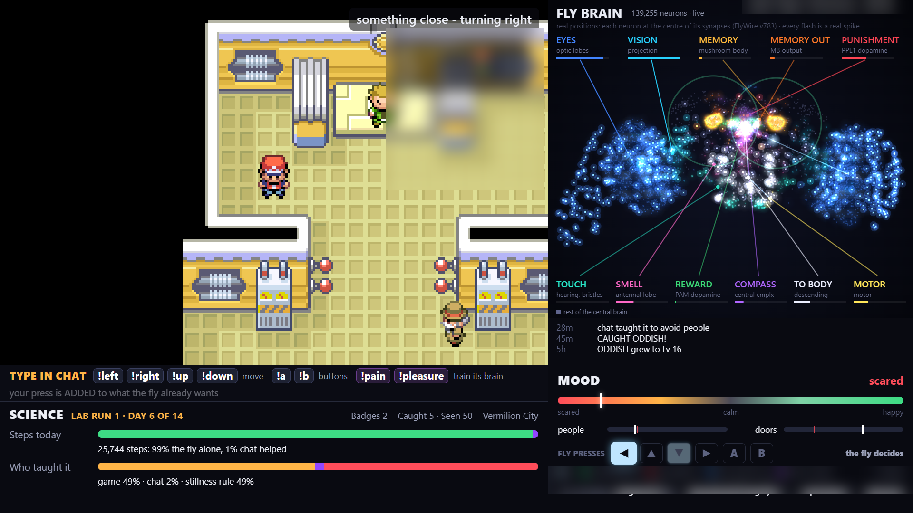

# Fly Brain Plays Pokémon

A simulated fruit-fly brain — **139,255 neurons wired from the FlyWire connectome** — plays
Pokémon FireRed on a Raspberry Pi 5, live, 24/7. Twitch chat can steer it and train it with
`!pain` / `!pleasure` (dopamine in the fly's learning centre). Every step, press and lesson is
attributed to the fly or to a human, runs last 14 days, and every run publishes weekly reports.

Live: [twitch.tv/leetzerzz](https://twitch.tv/leetzerzz) · [youtube.com/@leetzerzz](https://youtube.com/@leetzerzz)



## How it works

```
 ┌──────────────── Raspberry Pi 5 ────────────────┐        ┌────────────── Streaming PC ──────────────┐
 │  brain sim (139,255 spiking neurons, FlyWire)  │        │  OBS  ← browser layers:                   │
 │      eyes ← game frame    keys ← motor neurons │  LAN   │     Game     http://pi:8765/game          │
 │  mGBA (FireRed, your ROM)                      │ ─────► │     Brainviz http://127.0.0.1:8777/...   │
 │  relay  :8765  /game  /panel/live  /overlay   │        │     HUD      http://127.0.0.1:8777/hud    │
 │  Twitch chat bot, YouTube keeper, Discord,    │        │  flypanel.py  (status, drive, science,     │
 │  run clock (14-day runs), experiments, backups │        │   reports, guards, maintenance windows)   │
 └────────────────────────────────────────────────┘        └───────────────────────────────────────────┘
```

* **The Pi does all the thinking and playing.** The brain reads the emulator's framebuffer as its
  eyes, smells people and doors, feels bumps, and its descending neurons press the buttons. Nothing
  in the gameplay is scripted, battles included.
* **The PC only presents and streams.** OBS composes the game feed, a live brain map (every neuron
  at its real position, every flash a real spike) and an HTML HUD, all drawn on the PC's GPU.

## Repository layout

| folder | what |
|---|---|
| [`pi/`](pi/) | everything on the Raspberry Pi: brain simulation, game control, relay, chat bot, run clock, experiments, systemd units. See [`pi/README.md`](pi/README.md). |
| [`obs-pc/`](obs-pc/) | the streaming PC: control panel, HUD, live brain layer, run reports, supervisor and guards. See [`docs/OBS_PC_SETUP.md`](docs/OBS_PC_SETUP.md). |
| [`twitch-extension/`](twitch-extension/) | optional Twitch panel extension showing live science numbers. |
| [`science/`](science/) | preregistered experiments and independent recompute scripts. |
| [`docs/`](docs/) | architecture, setup, operations runbook, science notes, data licences. |

## Build your own

1. **Hardware:** Raspberry Pi 5 (16 GB recommended), NVMe or fast SSD, active cooling, an official
   27 W power supply; any Windows PC that can run OBS. Details in [`pi/README.md`](pi/README.md).
2. **Pi:** follow [`pi/README.md`](pi/README.md): OS image, install, download the FlyWire data,
   add **your own legally obtained FireRed ROM**, fill in the config, enable the services.
3. **Streaming PC:** follow [`docs/OBS_PC_SETUP.md`](docs/OBS_PC_SETUP.md): Python 3.12, OBS 30+,
   `config.json`, the panel, `setup_obs_scene.py`, the supervisor task.
4. **Accounts:** Twitch (chat bot login), optionally YouTube, Discord webhooks, Threads/Instagram.
   Every token lives in a git-ignored file; nothing secret is in this repository.

## Science

Every input is attributed: a step, battle move or milestone only counts as the fly's own if no human
key reached the game in the previous 5 seconds. Experiments are preregistered (method written before
any data) and checked by an independent recompute. Results so far:

* **Mirror world:** the fly turns left only ~45% of the time, and the lean survives mirroring the
  world — it comes from the simulated fly itself (connectome + our sensory/motor code), not the map.
* **Untrained vs trained:** accumulated training did not change how often it turns toward people
  or doors (no detectable effect), but it worsened its mood and made it walk more.

More in [`docs/SCIENCE.md`](docs/SCIENCE.md).

## Data, credits and licences

Code: MIT ([`LICENSE`](LICENSE)). Connectome: **FlyWire FAFB v783, CC-BY 4.0** — cite Dorkenwald et
al. 2024 and Schlegel et al. 2024 (Nature). **No ROM, save or game asset is included**; Pokémon is ©
Nintendo / Game Freak / The Pokémon Company. See [`docs/DATA_AND_LICENSES.md`](docs/DATA_AND_LICENSES.md).
